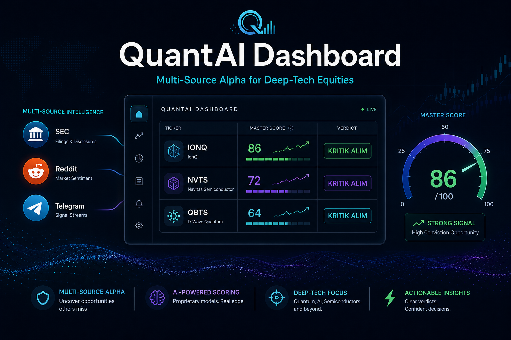
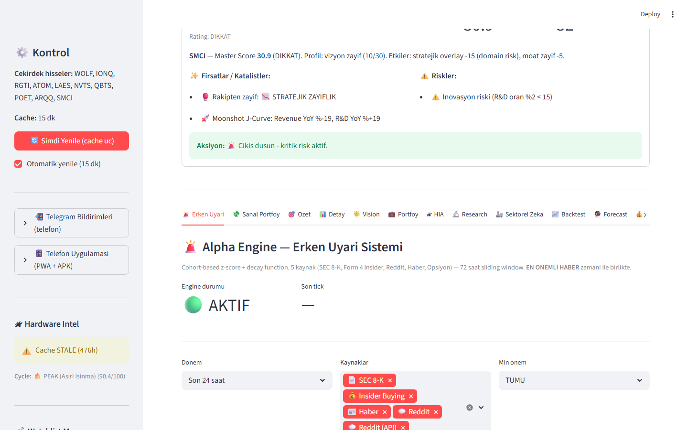
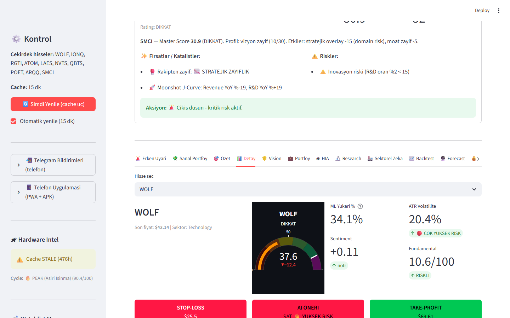

<p align="center">
  
</p>

<h1 align="center">QuantAI Dashboard</h1>

<p align="center">
  <strong>AI-powered semiconductor & quantum equity intelligence — Master Score, early-warning engine, Telegram alerts, and mobile access.</strong>
</p>

<p align="center">
  <a href="#-features">Features</a> •
  <a href="#-screenshots">Screenshots</a> •
  <a href="#-quick-start">Quick Start</a> •
  <a href="#-alpha-engine">Alpha Engine</a> •
  <a href="#-architecture">Architecture</a> •
  <a href="docs/PROMOTION.md">Marketing Kit</a> •
  <a href="Math_Specs.md">Math Specs</a>
</p>

<p align="center">
  
  
  
  
  
</p>

---

> **Disclaimer:** For education and research only. **Not financial advice.** Past signals do not guarantee future results.

## Why QuantAI?

Most retail dashboards show price and news. **QuantAI fuses:**

- **Multi-factor Master Score (0–100)** — technical timing, vision/roadmap, fundamentals, sentiment, plus 12+ strategic modifiers (moat, geo-risk, cash runway, moonshot J-curve, Lopez de Prado research coefficient).
- **Alpha Engine** — async early-warning system scanning **SEC 8-K, Form 4 insider buys, Google News, Reddit** with **cohort-aware z-scores** (MEGA / MID / SMALL cap).
- **Unified verdict language** — `KRITIK ALIM` → `GUCLU AL` → `AL` → `BEKLE` → `DIKKAT` → `SAT` everywhere (dashboard, Telegram, server).
- **Phone-first alerts** — Telegram push when multiple sources spike on the same ticker *before* the crowd moves.
- **Share anywhere** — Tailscale Funnel or cloud deploy; optional Android WebView APK.

Built for **semiconductor, quantum, and deep-tech watchlists** (IONQ, RGTI, NVTS, WOLF, LAES, QBTS, POET, SMCI, AXTI…).

---

## ✨ Features

| Layer | Capability |
|-------|------------|
| **Master Score v9** | 30/30/20/20 base + modifiers; Wilson CI on ML prob_up; Fama-French–style multi-factor design |
| **Investor Executive Summary** | Strategic role, critical thresholds (JDA, NIST PQC, Tier-1 OEM), foundry capex correlation |
| **ML stack** | XGBoost / sklearn, purged CV (Lopez de Prado), meta-labeling hooks |
| **Sentiment** | TextBlob + NLTK + RSS + yfinance news; critical keyword detector (InP, GaAs, SiC, export controls) |
| **Strategic overlays** | Quantum basket (IONQ/RGTI/QBTS), ATOM licensing, LAES post-quantum hardware |
| **Alpha Engine** | Minute-level ingestion, composite scoring, decay, cooldown, Turkish Telegram formatting |
| **Risk** | Monte Carlo 10y distribution, Black-Litterman, volatility smile, cash runway |
| **Mobile** | PWA + APK build scripts, `app_lite.py` for low-RAM servers |
| **Deploy** | Oracle Cloud bootstrap, systemd, nginx WebSocket proxy, Tailscale Funnel |

---

## 📸 Screenshots

| Dashboard overview | Investor summary | Early warning |
|:---:|:---:|:---:|
|  |  |  |

| Detail analysis | Telegram alert | Mobile |
|:---:|:---:|:---:|
|  |  |  |

> **First-time publish?** Run `.\scripts\capture_screenshots.ps1` after starting the dashboard, then commit PNGs to `docs/screenshots/`.

---

## 🚀 Quick Start

### 1. Clone & install

```powershell
git clone https://github.com/YOUR_USERNAME/quant-ai-dashboard.git
cd quant-ai-dashboard
.\setup.ps1
```

### 2. Run dashboard (PC)

```powershell
.\run.bat
# or
.\venv\Scripts\streamlit run app.py
```

Open **http://localhost:8501**

### 3. Share with friends (internet link)

```powershell
.\paylasim_baslat.bat
```

Requires [Tailscale](https://tailscale.com/download) + Funnel enabled on your tailnet. Share your `https://YOUR-NODE.tailXXXX.ts.net` URL — **no Tailscale account needed for visitors**.

See [PAYLASIM.md](PAYLASIM.md) (Turkish) / [docs/SHARING.md](docs/SHARING.md) (English).

### 4. Alpha Engine + Telegram (optional)

```powershell
cd alpha_engine
copy .env.example .env
# Fill: SEC_USER_AGENT, TELEGRAM_BOT_TOKEN, TELEGRAM_CHAT_ID
..\venv\Scripts\python.exe main.py --tick 60
```

---

## 🚨 Alpha Engine

Standalone asyncio service — runs alongside or without the full dashboard.

```
SEC 8-K ──┐
Form 4 ───┼──► Signal Bus ──► Cohort z-score ──► Composite ──► Telegram
Reddit ───┤         ▲                              │
Google ───┘         └── decay + cooldown ◄─────────┘
```

**ALPHA EVENT** fires when **2+ independent sources** anomaly-spike on the same ticker (thresholds vary by MEGA/MID/SMALL cohort).

**Severity:**

- 🚨 **KRITIK** — SEC filing, insider purchase, 3+ sources, or extreme negative sentiment cluster  
- ⚡ **YUKSEK** — corroborated multi-source spike  

Read more: [alpha_engine/README.md](alpha_engine/README.md)

---

## 🏗 Architecture

```
quant-dashboard/
├── app.py                 # Full Streamlit dashboard (40+ modules)
├── app_lite.py            # Server-lite: early warning + score table only
├── verdict_rules.py       # Single source of truth for buy/hold/sell labels
├── master_score.py        # Master Score v9 formula
├── ticker_analyze_core.py # Headless analysis (server / cron)
├── score_job.py           # Periodic score + Telegram (core watchlist)
├── alpha_engine/          # Production early-warning orchestrator
├── deploy/                # Oracle Cloud, systemd, nginx, bootstrap
├── phone_app/             # PWA / mobile shell
├── docs/                  # Screenshots, promotion kit, sharing guide
└── Math_Specs.md          # LaTeX-grade formula documentation
```

**Verdict bands (unified everywhere):**

| Master Score | Label |
|-------------:|-------|
| ≥ 85 | KRITIK ALIM |
| ≥ 70 | GUCLU AL |
| ≥ 55 | AL |
| ≥ 40 | BEKLE |
| ≥ 25 | DIKKAT |
| < 25 | SAT |

Cash runway & supply-chain critical alerts can **downgrade** to DIKKAT without inflating scores.

---

## ☁ Cloud deploy (optional)

One-command Oracle Free Tier setup:

```bash
bash deploy/bootstrap.sh
```

Docs: [deploy/ORACLE_KURULUM.md](deploy/ORACLE_KURULUM.md)

---

## 📚 Research foundations

Documented in [Math_Specs.md](Math_Specs.md) and [OGRENME_KITAPLARI.md](OGRENME_KITAPLARI.md):

- Fama & French — multi-factor structure  
- Lopez de Prado — purged CV, meta-labeling, MDA dynamic coefficient  
- Wilson score interval — ML confidence bounds  
- Fisher scuttlebutt — R&D-intensive qualitative overlays  

---

## 🤝 Contributing

Issues and PRs welcome. Please **never commit** `.env`, Telegram tokens, or API keys.

---

## 📣 Spread the word

Ready-made copy for Reddit, Hacker News, Twitter/X, Product Hunt, LinkedIn:

**→ [docs/PROMOTION.md](docs/PROMOTION.md)**

---

## ⚖ License

MIT — see [LICENSE](LICENSE). Educational use only; not investment advice.

---

<p align="center">
  <sub>Built with Python, Streamlit, and too much caffeine ☕</sub><br/>
  <sub>⭐ Star this repo if QuantAI helps your research workflow</sub>
</p>
